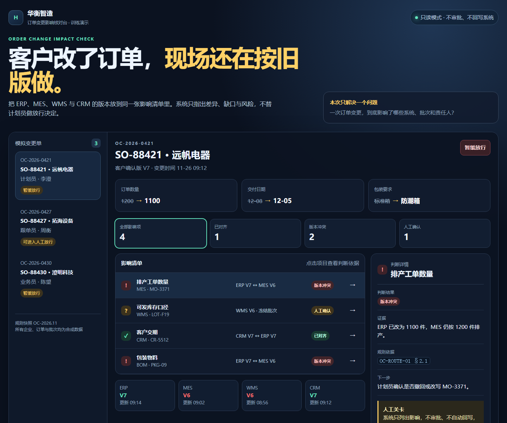
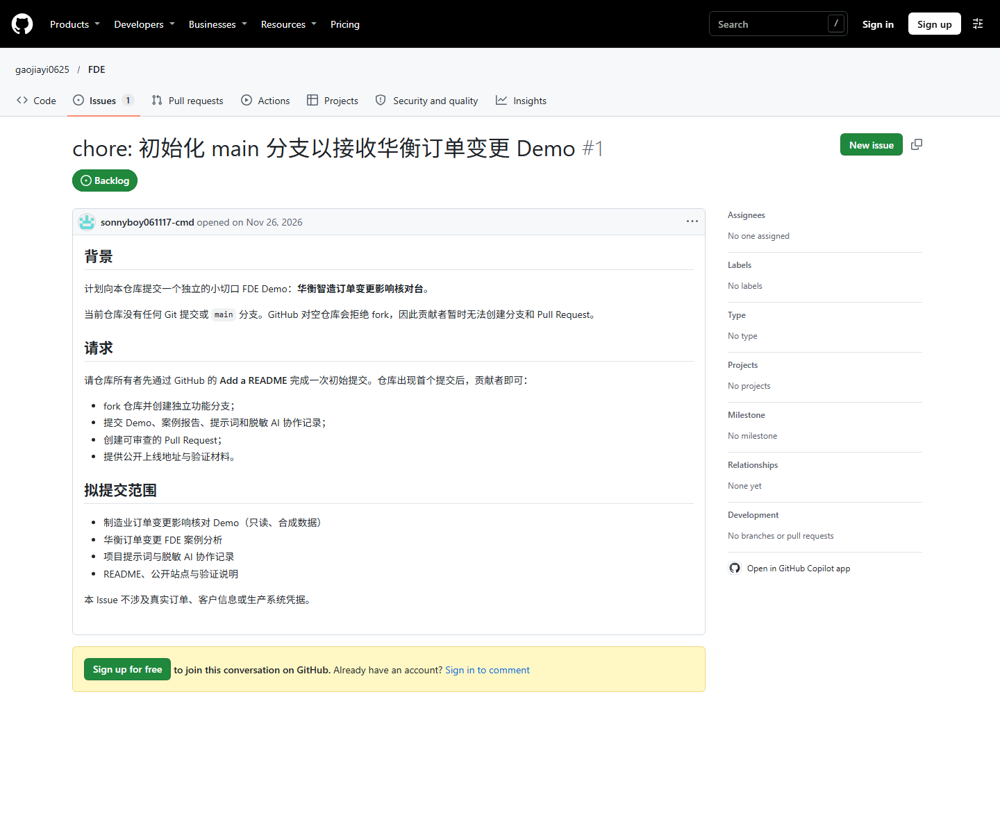

# 华衡智造 · 订单变更影响核对台

一个面向制造业订单变更场景的小切口 FDE Demo。

> 核心问题不是“变更传递慢”，而是没有一个所有人都认可的批准版本。系统只生成只读影响清单，不审批订单、不自动改写 ERP/MES/WMS，也不替代计划员放行。

## 在线体验

- [公开 Demo](https://sonnyboy061117-cmd.github.io/huaheng-order-change-impact-demo/)
- [完整暂存仓库](https://github.com/sonnyboy061117-cmd/huaheng-order-change-impact-demo)
- [目标仓库初始化 Issue #1](https://github.com/gaojiayi0625/FDE/issues/1)

## Demo 能做什么

- 在三条合成订单变更之间切换
- 对比数量、交期和包装要求的变更前后差异
- 查看 ERP、MES、WMS、CRM 的版本与更新时间
- 标记已对齐、版本冲突和必须人工确认的影响项
- 对“冻结批次计入可发数量”执行零容忍拦截
- 展示证据、规则依据和下一步责任人

## 明确不做

- 不执行订单审批
- 不自动回写业务系统
- 不自动调整排产或库存
- 不计算真实财务损失
- 不使用真实客户、订单或生产数据

## 项目资料

- `index.html`：公开 Demo 入口
- `site/index.html`：Demo 源文件
- `docs/华衡订单变更-案例分析.md`：FDE 案例分析
- `prompts/华衡订单变更项目主提示词.md`：项目提示词
- `ai-collaboration/AI协作记录.md`：脱敏 AI 协作记录
- `deliverables/huaheng-order-change.zip`：原始案例资料包
- `docs/evidence/`：Issue、PR 与在线站点证据

## 目标仓库贡献状态

目标：[gaojiayi0625/FDE](https://github.com/gaojiayi0625/FDE)

该仓库当前没有任何 Git 提交或 `main` 分支，GitHub 明确禁止 fork 空仓库，因此暂时无法创建 Pull Request。已提交初始化请求：

[Issue #1：初始化 main 分支以接收华衡订单变更 Demo](https://github.com/gaojiayi0625/FDE/issues/1)

仓库所有者只需点击 **Add a README** 完成首个提交。之后即可 fork、创建功能分支并提交完整 PR。

## 数据说明

所有公司、人物、订单、批次和数量均为合成训练内容，不包含任何真实生产数据或商业机密。
